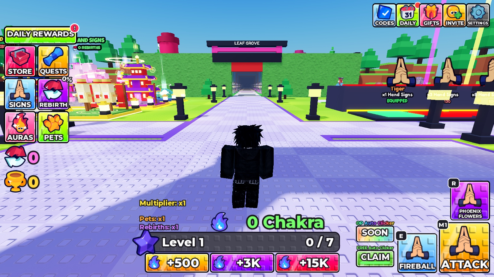
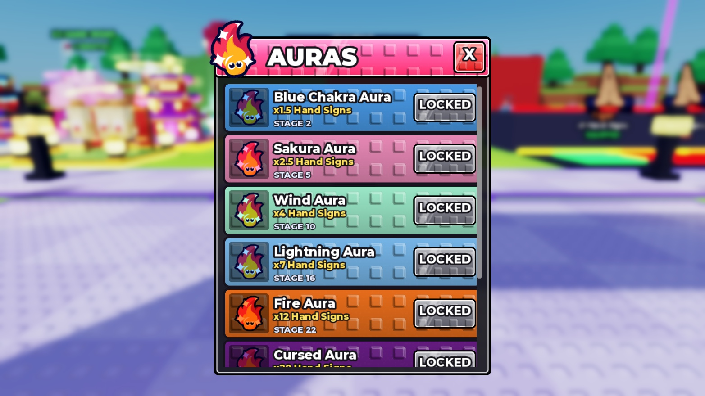

# Anime Eyes reference UI and combat repair — November 3, 2026

Applied to the open **+1 Anime Hand Signs** place, ID **72288975594385**, using the official Roblox_Studio MCP. Six source files were changed and read back byte-for-byte. All 50 stages remain. This is a tested repair pass, **not a claim of complete 1:1 parity** with another game.

## Reference evidence

- [Official +1 Anime Eyes experience](https://www.roblox.com/games/97617452700163/1-Anime-Eyes).
- [OrangeIsShort gameplay footage](https://www.youtube.com/watch?v=GqlsNcj3KSo): directly inspected frames at 0:29, 0:59, 1:42, 3:24, 5:06, 6:48, 8:30 and 8:50. The visible reference uses a six-tile left menu, compact top utilities, center-bottom Chakra/level progress, triangular M1/E/R controls, studded gradients, a narrow aura list, and a compact rebirth panel. Footage also shows stage clears and physical upgrade pads.
- Third-party guides disagreed about stage/eye counts and prices. Their unverified numbers were **not** used to replace the existing 50-stage economy. Exact enemy AI, paid systems, and full progression parity cannot be established from sampled footage.

## Applied changes

| Area | Change |
|---|---|
| HUD | Removed the duplicate root scale; bounded the Chakra counter; kept the reference triangle and six-tile layout. Portrait controls clear the native movement/jump controls. Purchase shortcuts move out of the portrait combat area while remaining in Store. |
| Menus | Narrow aura sheet with readable name, multiplier, unlock requirement and action; viewport-aware dimensions; two-column sign cards on narrow phones; grids refresh after rotation. |
| Motion | Button press feedback scales the current layout instead of restoring stale dimensions. Rotation cancels old position tweens. Hidden HUD elements move completely outside the viewport. |
| Combat | Holding Attack repeats server-validated punches; a tap still trains once. Release, focus loss, death or opening a menu stops held attack. Existing free-auto training remains separate. |
| Enemies | Open-front hoods, original eye details and vest accents; smaller overhead labels; local separation between nearby rigs; deterministic spawn order. Delayed enemy hits re-check the player's current character/stage. Missing spawn folders no longer permanently mark a set as spawned. |
| Presentation | Enabled the previously dormant local presentation module: lower lamp/bloom glare, distance-limited showcase labels, biome-colored entrance walls. Handles both same-named wall halves. |

Preserved: hand-sign abilities and artwork, Chakra display wording, the owner's stud texture and color palette, 50 stages, current economy, existing stations/models, training VFX, rewards and server authority. No builders were run and no map objects were deleted. Original source clones are in `ServerStorage.Backups.Codex_PreReferenceRepair_20261103`.

## Playtest findings

| Test | Result |
|---|---|
| Fresh join | `DataLoaded=true`, `TemporaryProfile=true`; exactly one root HUD scale. Console only reported the existing Studio data-isolation message. |
| Desktop | Tested average-laptop simulator, viewport 1365×768. HUD, aura sheet, open/close animation and rotation back from phone inspected. |
| Phone | Fresh iPhone 17 Pro portrait session; viewport 401×778. Both touch and keyboard can be reported, so keyboard availability no longer suppresses touch layout. Auras opened and all eight rows were visible; movement/jump controls remained available. |
| Rotation during menu close | Reproduced stale desktop positions in the initial candidate; cancelled in-flight slide tweens and retested. Hidden progress moved below the viewport (Y=1459 vs viewport height 778). |
| Held attack | In Stage 1, a 2.5-second hold killed two 100-HP enemies at about 100 Chakra; three enemies remained. Server showed 6 trophies and Level 2. |
| E/R and gate | E/R killed the remaining three enemies. Highest/GateReach advanced to 2, trophies to 15, Level to 4. Walked through the gate into Stage 2. |
| Trophy validation | ClaimWins(1) from Stage 2 rejected with “Collect your wins in the stage”. Returned to Stage 1 pad; trophies increased 15→45. Immediate return-to-lobby flag was sampled before it settled and is not counted as a separate verified result. |
| Invalid progression | NaN teleport did not move the player. TeleportStage(50) from a fresh profile did not unlock/move to Stage 50. BuySign(Ram) rejected for insufficient trophies. |
| Damage / respawn | Idle player took enemy damage and respawned in the lobby. No invincibility or progression grants were used. |
| Source / stage checks | All 30 current source containers compiled. All 50 stage folders retained six spawn markers each (five regular plus optional boss marker). Six edited source files read back exactly. |

No production save access, purchases, publication or merge occurred. Studio is stopped and device simulation is restored to default. The existing Studio-only memory profile guard remains intact. Tests used ordinary remotes and UI input, with no economy grants.

## Screenshots

These are actual Studio captures, not mockups. Images can be opened directly by a reader or an image-capable assistant with repository access. This Markdown index supplies context; screenshots alone do not prove gameplay.

- [Before: desktop](screenshots/nov3-before-desktop.jpg)
- [Before: oversized aura menu](screenshots/nov3-before-auras-settled.jpg)
- [After: final desktop](screenshots/nov3-desktop-final.jpg)
- [After: narrow aura menu](screenshots/nov3-after-auras.jpg)
- [After: enemy appearance and spacing](screenshots/nov3-enemy-combat.jpg)
- [After: final phone HUD](screenshots/nov3-mobile-final.jpg)
- [After: phone aura menu](screenshots/nov3-mobile-menu-final.jpg)

## Remaining work, ranked

1. **High — full progression and multiplayer validation.** This session clears Stage 1 and enters Stage 2, not all 50 stages. Test two players' enemy visibility/ownership, boss death/teleport races, all later sign abilities, rebirth loops and final boss phases before release.
2. **High — unfinished systems.** Pet Fuse/Boss Shop remain the existing stubs. Product IDs and purchase receipt durability need a dedicated implementation/review before enabling monetization. This pass does not make them operational.
3. **Medium — complete visual parity.** Later biomes, stage gates, enemy animation/silhouette variety and the remaining menus still need systematic comparison. The reference's full game was not directly played; sampled footage is the evidence boundary. Large lobby billboards and Advanced/Forbidden placeholder art remain visible issues.
4. **Medium — input and performance coverage.** A physical phone, controller and multiplayer session were not tested. Portrait Signs grid received a two-column fix but the final two-column view was not separately captured. Landscape phone performance and later-stage VFX load need profiling.
5. **Medium — source drift / rebuild tools.** Claude's latest repository LobbyBuilder differs from the live baseline. It was not overwritten or run. The old WorldBuilder remains unsafe; do not rebuild the place from it. Continue explicit source comparison before imports.

## Repository and preservation notes

Branch starts from Claude's `5df3da8f5d55e10274ad3f12ad5a537e90c4cf6c` and is stacked on `feature/issue-14-lobby-stage-pilot` / PR #16. The five existing changed script files matched that commit before edits; Presentation is a new repository file already present in Studio. `scripts/` contains the six exact final sources. `source-snapshots.zip` preserves all 30 November 3 baseline sources and candidates. `changes.patch` shows only this repair pass.

The user-created full place backup remains `AnimeHandSigns-before-Codex-2026-11-02.rbxl` in the parent output folder (SHA-256 `A093D72176EEDB641C15AAED35B8E0D7C405529A1B93B349B2BF6C0D9EA5E611`). This source ZIP is not a full place file. Changes are applied in open Studio; saving a new full-place disk file is not verified. Earlier full inspection evidence is in [PR #12](https://github.com/zeringflix/anime-hand-signs/pull/12).
