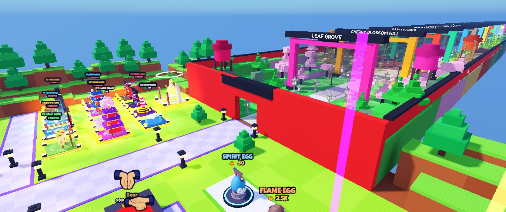
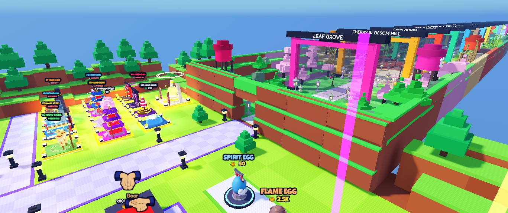
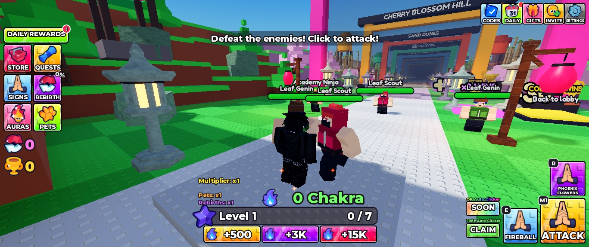
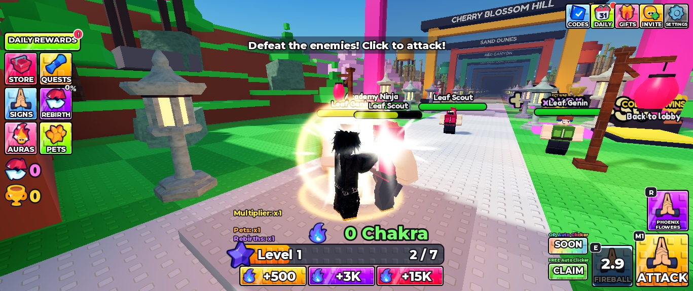

# Map, combat visuals and character lifecycle repair

Place: **+1 Anime Hand Signs**, 72288975594385. Inspected and edited through the official Roblox Studio MCP connection. Session date: November 3, 2026 (America/Chicago).

## Delivered in this pass

- Replaced the flat red entrance presentation with warm earth faces, stepped grass shelves and studded tops. The 72 added parts are decorative and noncolliding; the original entrance opening and collision walls remain.
- Finished the cliffs and upper perimeter walls in all 50 stages. Green biomes use soil under grass; other biomes retain their individual color families. No stage rebuild was run. All 300 spawn markers, gate barriers, trophy pads and Claude's lobby stations remain.
- Added pupils, brows, forearm wraps, vest closure and belt pouches to existing animated enemy rigs. Boss embers now use an explicit texture. No external character model was substituted.
- Ground rings and explosion columns raycast onto the actual map surface. Fire projectiles have smaller halos and ember tails; impact lighting and flash opacity are reduced.
- Guarded delayed charge effects against removed characters and projectile rendering against removed targets.
- Cancelled a charged dash when its caster dies, enters the lobby, or changes stage. Clones stop when their owner dies/leaves combat. Character removal clears temporary walls, defenses and companions. Transformation attacks stop on death and recheck after their wait. Per-jutsu cooldowns remain intact.
- Added `Assets.JutsuIconsById` and independent E/R lookup using the actual jutsu IDs. **The approved image mapping is intentionally empty:** finished attack artwork has not been located. Existing hand images remain as the fallback.

## Screenshots

These are actual Studio captures, not mockups. The combat screenshot uses a temporary test character with increased health to allow inspection.

| Before | After |
| --- | --- |
|  |  |

## Validation

| Check | Result |
| --- | --- |
| Compile all active Lua source containers | 31 compiled, zero syntax failures |
| Stage integrity | 50 finished stages; 300 enemy spawn markers; all 50 gate barriers present |
| Repeat map finish | No duplicate added parts |
| Restore map, then reapply | Original red entrance restored; decorative model archived; finish reapplied successfully |
| Data isolation | Runtime reported Studio profiles use memory only and never read/write production data |
| E/R keyboard input | Fireball and PhoenixFlower cast; enemy HP decreased; server recorded each jutsu |
| Hold M1 for three seconds | Two enemies defeated; trophies increased to 6 and level to 2 |
| Elevated surface | Impact ray returned Y=21.1200008 on a pad whose top is Y=21 |
| Character removed during charge | Delayed callback completed without a VFX script error |
| All 28 impact variants | Invoked each configured jutsu's impact; zero script errors |
| Clone death cleanup | Two Shadow Clones before death, zero afterward |
| Chidori death during wind-up | No damage dealt after the caster died |
| Susanoo death during wind-up | No transformation damage dealt after the caster died |
| Test fixtures | Created only in play mode; absent from the Edit DataModel |

A pre-existing debris texture briefly reported that Roblox was generating its content representation. Explicit preload of that texture and the spark texture then returned `Success`. This was not treated as a permanent asset failure. No production save, purchase, publication or merge occurred. These checks are single-player Studio tests, not a complete 50-stage combat playthrough or a multiplayer/performance certification.

## Preservation and reproducibility

Before edits, six original scripts were cloned under `ServerStorage.Backups.Codex_PreMapVFX_20261103`. Source snapshots and the patch are included here. Existing prior-pass backups were retained.

The map changes are represented by `scripts/ServerStorage/Tools/ReferenceMapPolish.luau`. After loading that module into the existing place, run `ApplyRange(first, last)` in small stage batches (1–10, 11–20, etc.). Do not run the old world builder. Every changed property is stored on its original part under `ReferenceFinishOriginal_*`; `Restore()` reinstates those properties and archives the added facade instead of deleting it. The finish has already been applied to the currently open Studio place. GitHub holds source and reproduction instructions, not an exported new `.rbxl`.

## Remaining work, ranked

1. **High — approved E/R artwork:** repository contains the approved hand art and 28-icon specification, but no finished attack-specific set was found in the inspected branch, local workspace or matching Fireball/Phoenix inventory results. Owner has been asked for its location or Roblox IDs. Do not invent asset IDs or redraw the approved seal anatomy. Advanced/Forbidden poses remain unapproved in the existing specification.
2. **High — reference parity:** this is a repair pass, **not verified 1:1 reproduction**. The reference footage supports the stepped earth/grass visual direction and compact HUD, but precise reference stage layouts, enemy behavior, economy, ability timing and all effects have not been measured. Keep hand-sign gameplay as the owner requested.
3. **Medium — complete visual review:** inspect every finished biome in play mode, test all 28 complete ability mechanics (not just impacts), and review final boss phases. Existing detailed audit remains relevant.
4. **Medium — multiplayer and devices:** test ownership isolation, companion visibility, busy combat frame times and physical mobile input. Previous phone UI checks are documented separately; this pass did not rerun a full device matrix.

Reference footage previously inspected: [Starting Over as NOOB with BEST EYES in +1 Anime Eyes!](https://www.youtube.com/watch?v=GqlsNcj3KSo). The visual direction is an observation from that footage; exact gameplay equivalence is not claimed.
